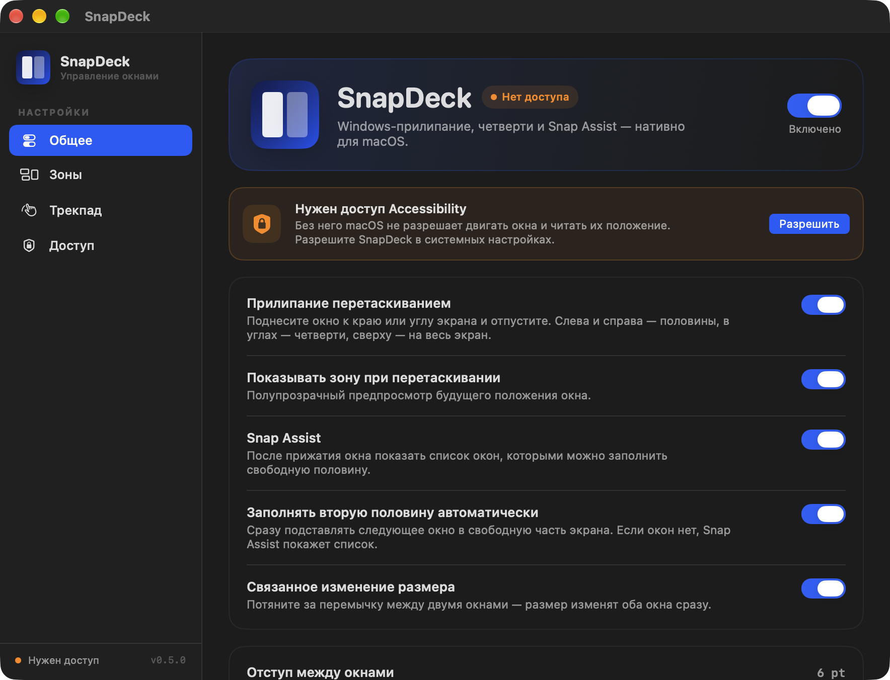
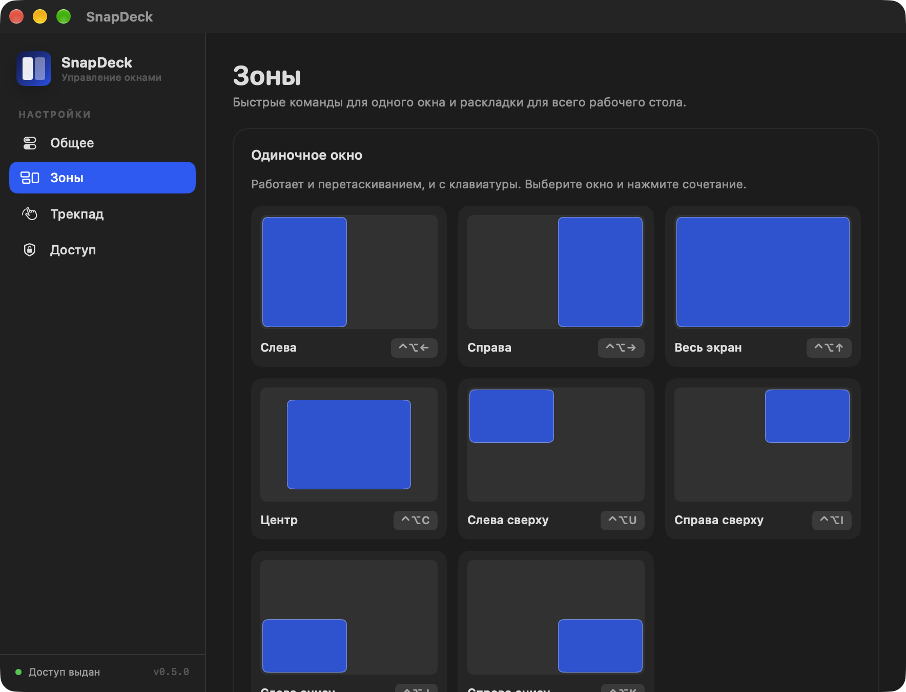
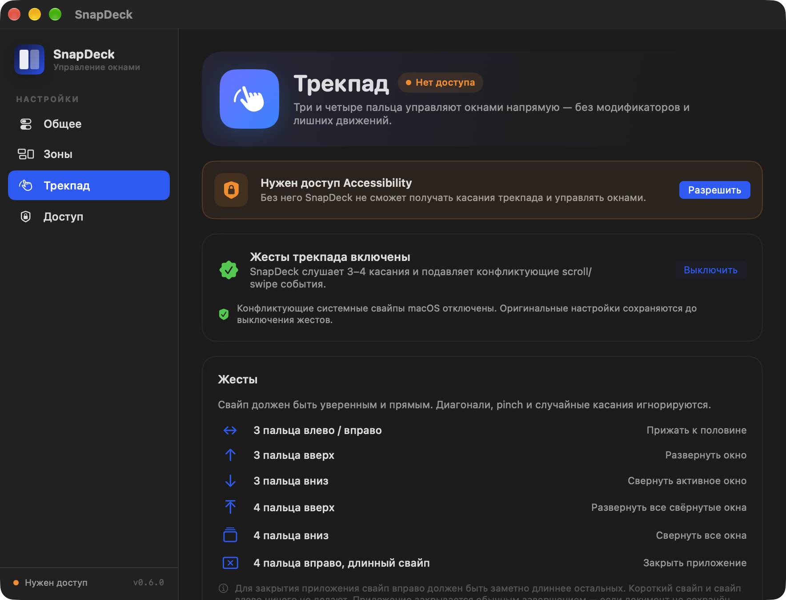

# SnapDeck

**SnapDeck** — черновой нативный менеджер окон для macOS в духе Windows Snap: прилипание к краям, четверти, Snap Assist, автоматическое заполнение второй половины и раскладки для всего рабочего стола. Название рабочее, его можно поменять.

> Статус: рабочий прототип `0.6.1`. Оконное ядро и жесты трекпада готовы к проверке на реальном Mac с выданным Accessibility.



<table>
<tr>
<td></td>
<td></td>
</tr>
</table>

## Что уже работает

- **Прилипание перетаскиванием** — потяните окно за заголовок к краю экрана:
  - левый/правый край — половина;
  - верхний край — на весь экран;
  - нижний край — нижняя половина;
  - углы — четверти.
- **Предпросмотр в стиле Liquid Glass** — размытый фон, рассеянный свет, одна едва заметная обводка. Без акцентного красного/синего контура.
- **Возврат к исходному размеру при отлипании** — если потянуть прижатое окно за заголовок, оно сразу восстанавливает размер и положение, которые были до прилипания.
- **Snap Assist с живыми миниатюрами** — центрированная стеклянная панель в свободной половине с превью окон; выбор сразу перемещает и поднимает нужное окно. Если на экране нет других окон, показывает свёрнутые окна и разворачивает выбранное на второй половине. Без разрешения Screen Recording показывает иконки приложений.
- **Связанное изменение размера** — между двумя окнами появляется нейтральная стеклянная перемычка длиной 112 pt; потяните её, и оба окна изменят размер одновременно.
- **Жесты трекпада** — 3 пальца влево/вправо прижимают окно к половине, вверх разворачивают, вниз сворачивают активное окно; 4 пальца вниз сворачивают все окна, вверх разворачивают свёрнутые, длинный свайп 4 пальцами вправо закрывает приложение. Используется MultitouchSupport с подавлением конфликтующих scroll/gesture событий.
- **Автозаполнение второй половины** — опционально подставляет следующее подходящее окно без выбора.
- **Клавиатурные команды** для половин, углов, центра, максимизации, восстановления размера и переноса между дисплеями.
- **Массовые раскладки** из меню: две колонки, три колонки, сетка, «главное окно + стек», «главное окно сверху», каскад.
- **Мультидисплейность** с выбором экрана по положению окна/курсора и сохранением относительного положения окна при переносе.
- **История кадров** для команды «Вернуть размер» (аналог Undo).
- **Настройки** на SwiftUI: отступ между окнами, автозапуск, разрешения, диагностика.
- **Menu bar-only** приложение без иконки в Dock.
- **Локальная работа** без сети, аналитики и телеметрии.

### Жесты трекпада

Включите их во вкладке **Трекпад**. При включении SnapDeck:
- сохранит текущие настройки системных свайпов;
- отключит конфликтующие свайпы macOS (Mission Control, App Exposé, переключение приложений);
- перезапустит Dock один раз для применения;
- запустит собственный MultitouchSupport-движок.

4 пальца вправо закрывают приложение только при **длинном** свайпе; короткий свайп ничего не делает. Приложение завершается обычным quit-запросом, поэтому несохранённый документ вызовет системный диалог сохранения. Finder и сам SnapDeck не закрываются.

При выключении исходные системные настройки восстанавливаются. Если включён **«Перетаскивание тремя пальцами»** в Универсальном доступе, его лучше отключить: он конфликтует со свайпами.

## Установка

1. Скачайте `SnapDeck-<версия>.dmg` со страницы [Releases](https://github.com/belyi2000/SnapDeck/releases/latest).
2. Перетащите **SnapDeck** в `/Applications`.
3. Первый запуск: правый клик по приложению → **Открыть**. Приложение подписано ad-hoc, без нотаризации Apple, поэтому обычный двойной клик macOS может заблокировать.

Обновления проверяются только вручную: **иконка SnapDeck в строке меню → «Проверить обновления…»**. Фоновая проверка и телеметрия отключены. Если новая версия найдена, Sparkle скачает подписанный архив, проверит подпись и предложит перезапуск.

## Быстрый старт

Требования: macOS 14+, Apple Silicon (сборка проверена на Mac mini M2, macOS 27.2), Command Line Tools с Swift 6.3. Полный Xcode не обязателен.

```bash
git clone https://github.com/belyi2000/SnapDeck.git
cd SnapDeck
./Scripts/build-app.sh
open dist/SnapDeck.app
```

Или только сборка:

```bash
swift build
swift run SnapDeckChecks
```

Готовый бандл: `dist/SnapDeck.app`.

### Первый запуск

1. Откройте **Настройки → Доступ**.
2. Нажмите **Открыть** рядом с **Универсальный доступ (Accessibility)** и включите SnapDeck.
3. Для перетаскивания также включите **Мониторинг ввода (Input Monitoring)**, если macOS его запросит.
4. Вернитесь в SnapDeck и нажмите **Перезапустить** у монитора перетаскивания.
5. Для живых миниатюр в Snap Assist разрешите **Запись экрана (Screen Recording)**.
6. Уберите второй контур при перетаскивании:
   - нажмите **«Убрать второй контур»** в баннере SnapDeck;
   - либо вручную: **Системные настройки → Рабочий стол и Dock → Окна → Перетаскивать окна к краю экрана для мозаики — выкл.**
7. Откройте вкладку **Трекпад** и нажмите **«Включить жесты»**. SnapDeck сохранит и отключит конфликтующие системные свайпы, затем один раз перезапустит Dock.
8. Поставьте приложение в `/Applications`, если нужен стабильный автозапуск.

> Ad-hoc подпись меняется при пересборке. Если macOS сбрасывает Accessibility после `./Scripts/build-app.sh`, выдайте доступ заново. Для повседневного использования нужна стабильная подпись (Developer ID) либо установка `.app` в `/Applications` без пересборки.

## Горячие клавиши

| Команда | Сочетание |
|---|---|
| Левая половина | `⌃⌥←` |
| Правая половина | `⌃⌥→` |
| Развернуть | `⌃⌥↑` |
| Вернуть размер | `⌃⌥↓` |
| По центру | `⌃⌥C` |
| Левый верхний угол | `⌃⌥U` |
| Правый верхний угол | `⌃⌥I` |
| Левый нижний угол | `⌃⌥J` |
| Правый нижний угол | `⌃⌥K` |
| Предыдущий дисплей | `⌃⌥⇧←` |
| Следующий дисплей | `⌃⌥⇧→` |

Массовые раскладки доступны из меню SnapDeck в строке состояния. В настройках можно изменить отступ (0–24 pt) и включить автозаполнение.

## Snap Assist

После прижатия к половине SnapDeck показывает в свободной области панель с окнами-кандидатами. Одновременно загружаются живые миниатюры через ScreenCaptureKit; приложение, заголовок и превью помогают выбрать нужное окно. Клик или клавиши `1–6` заполняют вторую половину, `Esc` закрывает панель.

Без Screen Recording панель остаётся рабочей: вместо превью показываются иконки приложений и кнопка включения доступа.

## Перемычка между окнами

Когда SnapDeck составил пару из двух половин (через Snap Assist, автозаполнение или два последовательных snap), между окнами появляется маленькая синяя перемычка. Потяните её — оба окна изменят размер, как в Windows Snap. Перемычка исчезает, если окно закрыть или увести из пары. Отключается в **Общее → Связанное изменение размера**.

## Архитектура

```
Sources/
  SnapDeckCore/                  # тестируемое ядро без UI
    SnapZone.swift               # геометрия зон, координаты AX ↔ Cocoa
    EdgeDetector.swift           # край/угол → зона
    TilingPreset.swift           # раскладки для N окон
    AccessibilityWindowService   # публичный Accessibility API
    WindowFrameHistory.swift     # Undo кадров
    HotKeyManager.swift          # Carbon global hotkeys
    PermissionManager.swift      # TCC-статусы и macOS Settings deeplinks
    WindowCommand.swift          # единая модель команд
    TrackpadGesture.swift        # словарь будущих жестов
  SnapDeck/                      # приложение и UI
    App/SnapCoordinator.swift    # применение зон, Snap Assist, раскладки
    Snapping/EdgeSnapMonitor     # listen-only CGEventTap
    Snapping/SnapPreview...      # прозрачный предпросмотр
    Snapping/SnapAssist...       # non-activating панель выбора окна
    UI/                          # SwiftUI настройки
Tests/SnapDeckChecks/            # автономный раннер проверок
```

Ключевые решения:

- **Публичный Accessibility API** для позиции/размера окон. Без приватного WindowServer API в оконном ядре.
- **`CGEvent.tapCreate(... .listenOnly)`** для отслеживания перетаскивания. Приложение не перехватывает и не подменяет клики.
- **Cocoa/AX conversion**: AX работает от верхнего левого угла основного дисплея, AppKit — от нижнего левого. Конверсия вынесена в `ScreenGeometry` и покрыта проверками.
- **Non-activating NSPanel** для превью и Snap Assist: панель не активирует SnapDeck и не уводит фокус из рабочего приложения.
- **Единый `WindowCommand`** — клавиатура, меню, края и будущие жесты используют один и тот же путь применения.
- **Event tap перезапускается** после смены разрешений и при активации приложения.

## Релизы

```bash
./Scripts/release.sh 0.6.1
```

Скрипт поднимает `CFBundleVersion`, собирает `.app`, делает DMG для установки и ZIP для Sparkle, подписывает appcast ключом EdDSA из Keychain, создаёт git-тег и публикует релиз через `gh`. Нужен установленный и авторизованный [GitHub CLI](https://cli.github.com/).

Приватный ключ Sparkle хранится в связке ключей macOS и в репозиторий не попадает. Сделайте резервную копию:

```bash
.build/artifacts/sparkle/Sparkle/bin/generate_keys -x ~/Documents/sparkle-private-key.txt
```

Публичный ключ уже прописан в `Resources/Info.plist` (`SUPublicEDKey`). Если ключ потерян, обновления перестанут устанавливаться — его нельзя восстановить.

## Проверки

```bash
swift run SnapDeckChecks
```

Сейчас: **137 проверок**, включая геометрию половин/третей/четвертей, отступы, AX↔Cocoa, мультидисплей, детектор краёв с учётом menu bar, Snap Assist-зоны, раскладки, историю кадров, математику связанного resize, восстановление окна при отлипании и распознавание свайпов трекпада.

`swift test`/XCTest в текущем окружении недоступны: установлены только Command Line Tools, без XCTest.framework. Поэтому используется автономный исполняемый раннер. При установке полного Xcode тесты можно перевести на Swift Testing/XCTest.

## Известные ограничения

- Встроенное прилипание macOS нужно отключить — иначе два механизма конкурируют и видны два контура. SnapDeck предлагает сделать это одной кнопкой.
- Не все приложения разрешают менять размер через AX; некоторые окна игнорируют команды.
- Fullscreen-окна, диалоги и нестандартные окна пропускаются.
- Живые миниатюры требуют разрешения Screen Recording; без него Snap Assist работает в режиме иконок.
- Перемычка создаётся только для пар, которые SnapDeck сам прижал к половинам. Свободное ручное составление пары пока не распознаётся.
- Восстановление после отлипания работает для окон, прижатых текущим запуском SnapDeck; после перезапуска приложения состояние сбрасывается.
- Нет пользовательских зон и полноценных Snap Groups.
- Жесты трекпада используют приватный `MultitouchSupport`, поэтому приложение не подходит для Mac App Store.
- При включении жестов SnapDeck отключает конфликтующие системные свайпы и перезапускает Dock. Настройки можно вернуть, выключив жесты.
- Жесты работают в текущем запуске приложения; после перезапуска включаются автоматически, если были включены.
- Внешний вид и UX стоит проверить на реальном Magic Trackpad и на нескольких приложениях.

## Что дальше

- Snap Layouts HUD для выбора зоны прямо во время свайпа.
- Snap Groups с восстановлением пары после перезапуска.
- Пользовательская настройка направлений и количества пальцев.
- Стабильная подпись Developer ID, чтобы не выдавать Accessibility после каждой сборки.
- Тест на реальном Magic Trackpad: конфликты Mission Control/App Exposé и ложные срабатывания.

Подробнее — в [REPORT.md](REPORT.md).

## Лицензия

MIT. См. [LICENSE](LICENSE).
